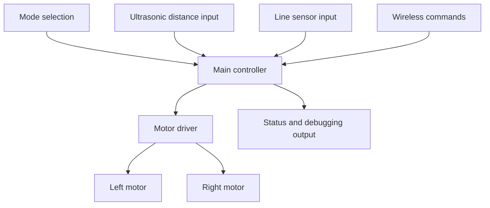

# Four-in-One Robotics Car

A modular Arduino-based robot car project exploring four capabilities on one platform: obstacle avoidance, line following, wireless control, and combined operation.

> **Project status: In development.** The motor-control stage is not working reliably yet. This repository records the actual build, experiments, design decisions, and future work. It does not claim that the complete robot has been finished.

## Project idea

The aim is to develop one robot car that can operate in different modes instead of building four separate vehicles.

| Mode | Intended behaviour | Status |
|---|---|---|
| Obstacle avoidance | Detect an object in front of the car and choose a safe movement response | Planned |
| Line following | Use line sensors to follow a marked path | Planned |
| Wireless control | Receive movement commands remotely through a wireless controller | Planned |
| Combined mode | Select or switch between the modes on the same car | Planned |

The modes will be developed and tested separately before being combined. This makes it easier to identify which part of the system is responsible when something does not work.

## Hardware under development

The current development work has involved:

- Arduino Uno — main controller for the initial prototype
- L298N dual H-bridge motor driver — motor-control interface
- DC geared motors — drive system
- HC-SR04 ultrasonic sensor — available for distance-measurement experiments
- Breadboard and jumper wires — prototype connections

Possible later additions include reflective IR sensors for line detection and an ESP32 for wireless communication. These are planned integrations, not completed features.

The exact final component list and power arrangement may change as the prototype is tested.

## System concept

The intended system is divided into separate parts:

The controller should decide what the car needs to do. The motor driver handles the higher-current motor switching. Sensors and wireless commands provide inputs to the controller.

## Development status

The first hands-on stage focused on understanding the Arduino, motor driver, DC motors, terminals, polarity, jumper caps, common ground, and soldering motor wires.

A basic motor movement test was attempted using the Arduino Uno and L298N. The motor did not rotate during the test. The exact cause has not been confirmed, so the issue is recorded as unresolved rather than being attributed to a particular component.

This is an important part of the project record: a prototype should be documented according to what was actually tested, not what it was intended to do.

See:
- [Development log](docs/DEVELOPMENT-LOG.md)
- [Motor test record](docs/TEST-LOG.md)
- [System architecture](docs/ARCHITECTURE.md)
- [Implementation plan](docs/IMPLEMENTATION-PLAN.md)
- [Reference projects](docs/REFERENCES.md)

## How the project will be developed

1. Establish reliable and repeatable motor control.
2. Test each sensor independently and record its output.
3. Implement obstacle-avoidance behaviour.
4. Add and test line detection and line-following behaviour.
5. Develop wireless control as a separate feature.
6. Add mode selection and combine the functions.
7. Test the complete system and document limitations.

A feature will be marked complete only after it has been tested on the hardware and the result has been recorded.

## Build evidence

Photos, circuit diagrams, code, and test results will be added as they become available. No demonstration image is used as evidence of a completed build.

## Learning and attribution

Public open-source projects were consulted for general ideas about modular robot design, line sensing, obstacle detection, and wireless control. Their code, images, diagrams, and written descriptions have not been copied into this repository. The selected references and the specific ideas studied are listed in [REFERENCES.md](docs/REFERENCES.md).

## Safety and limitations

This is an educational prototype, not a finished or safety-certified vehicle. Disconnect power before changing circuit connections, avoid short circuits, and use a suitable power source for the components being tested. Do not leave an experimental circuit running unattended.

---

*The repository will be updated as the hardware is tested. The goal is to show the real development process, including failures and changes, rather than to present an unfinished prototype as a completed product.*
